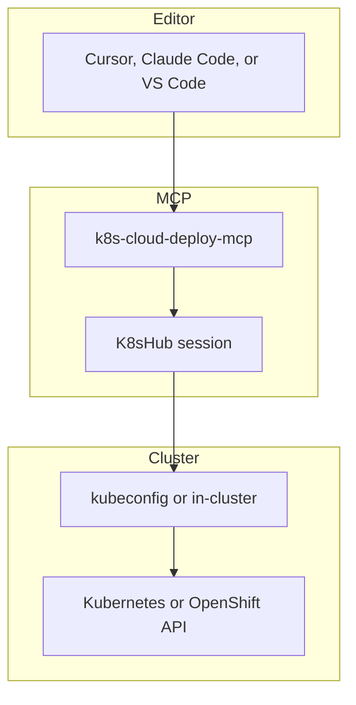

# k8s-cloud-deploy-mcp

MCP server owned by **Pawan Gunjkar** (`pawangunjkar@gmail.com` · [GitHub](https://github.com/Pawangunjkar/k8s-mcp)). MIT licensed.

The server targets standard Kubernetes, Red Hat OpenShift, and cloud-managed clusters (AWS EKS, Azure AKS, GCP GKE). It loads a kubeconfig context or an in-cluster service account, detects OpenShift from `apps.openshift.io/v1` or `route.openshift.io`, and reads `CLOUD_PROVIDER`, `AWS_REGION`, `AZURE_SUBSCRIPTION_ID`, `GCP_PROJECT`, and `K8S_CONTEXT`.

Read-only diagnostics run without a second confirmation. `k8s_trigger_deployment_rollout` and `k8s_rollback_deployment` return a plan until the caller sets `confirm=true` after the user approves it. Image updates must be `sha256` digests. The tag `latest` is rejected. Secret values are never returned.

## Project information

| Item | Value |
| --- | --- |
| Package | `k8s-cloud-deploy-mcp` |
| Command | `k8s-cloud-deploy-mcp` |
| Runtime | Python 3.10+, FastMCP, official Kubernetes client, httpx, pydantic |
| Auth | `KUBECONFIG`, `K8S_CONTEXT`, or in-cluster service account |
| Providers | `aws_eks`, `azure_aks`, `gcp_gke`, `openshift`, `generic_k8s` |

## Architecture



`kubectl` and `oc` are optional. The Python client is authoritative. Those binaries run only for client version and a short rollout-status check, with `shell=False` and a fixed argument list.

## Environment

| Variable | Role |
| --- | --- |
| `KUBECONFIG` | Kubeconfig file or path list |
| `K8S_CONTEXT` | Context name |
| `K8S_NAMESPACE` | Default namespace |
| `CLOUD_PROVIDER` | `aws_eks`, `azure_aks`, `gcp_gke`, `openshift`, or `generic_k8s` |
| `AWS_REGION` | Required with `aws_eks` |
| `AZURE_SUBSCRIPTION_ID` | Required with `azure_aks` |
| `GCP_PROJECT` | Required with `gcp_gke` |

Prepare the kubeconfig with `aws eks update-kubeconfig`, `az aks get-credentials`, `gcloud container clusters get-credentials`, or `oc login` before starting the server.

## Tools

Read-only: `k8s_get_cluster_overview`, `k8s_list_deployments_and_configs`, `k8s_get_pod_health_and_diagnostics`, `k8s_get_container_logs`, `k8s_manage_openshift_routes_and_services`, `k8s_check_rollout_status`.

Confirmation-gated writes: `k8s_trigger_deployment_rollout`, `k8s_rollback_deployment`. Pod delete still requires `confirm=true`.

The Agensi skill playbook is `agensi_build/k8s-cloud-deploy-mcp-pro/SKILL.md`.

## Cursor

```json
{
  "mcpServers": {
    "k8s-cloud-deploy-mcp": {
      "command": "uvx",
      "args": ["--from", "C:/AI_Workspaces/Anti_Workspace/k8s-mcp", "k8s-cloud-deploy-mcp"],
      "env": {
        "KUBECONFIG": "C:/Users/you/.kube/config",
        "K8S_CONTEXT": "dev",
        "CLOUD_PROVIDER": "generic_k8s"
      }
    }
  }
}
```

## Agensi package

```text
python scripts/build_agensi_zip.py
```

The scanner writes these files under `dist/`:

| File | Contents |
| --- | --- |
| `k8s-cloud-deploy-mcp-pro.zip` | Agensi skill upload |
| `k8s-cloud-deploy-mcp-pro.tar.gz` | Same skill as a tar archive |
| `k8s_cloud_deploy_mcp-1.1.0.tar.gz` | Python source distribution |
| `k8s_cloud_deploy_mcp-1.1.0-py3-none-any.whl` | Python wheel |

Upload the zip to [agensi.io/dashboard/submit](https://agensi.io/dashboard/submit). Install the wheel with `pip install dist/k8s_cloud_deploy_mcp-1.1.0-py3-none-any.whl`.
