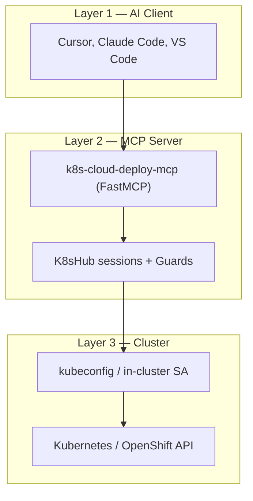

# Kubernetes & OpenShift MCP Server (`k8s-cloud-deploy-mcp`)

> A Python **Model Context Protocol (MCP)** server for **Kubernetes**, **Red Hat OpenShift**, and managed cloud clusters (**AWS EKS, Azure AKS, GCP GKE**) — cluster overview, pod health diagnostics, container logs, OpenShift Routes, immutable `sha256` digest rollouts, and confirmation-gated rollbacks.

[](https://www.python.org/downloads/)
[](https://modelcontextprotocol.io/)
[](LICENSE)

---

## Overview

**k8s-cloud-deploy-mcp** lets AI assistants inspect Kubernetes and OpenShift workloads, diagnose failing pods (`CrashLoopBackOff`, `OOMKilled`, event timelines), and execute safe, digest-pinned deployments.

- **Multi-cloud & OpenShift:** Automatically detects OpenShift (`apps.openshift.io/v1` / `route.openshift.io`), EKS, AKS, GKE, or standard Kubernetes clusters via `KUBECONFIG`, `K8S_CONTEXT`, or an in-cluster service account.
- **Safety guardrails:**
  - Read-only inspection tools run immediately without extra confirmation.
  - `k8s_trigger_deployment_rollout`, `k8s_rollback_deployment`, and `k8s_delete_pod` return a preview plan first and only apply when called with `confirm=true`.
  - Image updates enforce immutable `@sha256:...` digests and reject `:latest`.
  - `k8s_list_secret_names` returns secret metadata only — secret values are never exposed.

---

## Architecture & How It Works



- Uses the official Python `kubernetes` client as the authoritative API layer.
- `kubectl` / `oc` are optional and only invoked for client version checks and `rollout status` verification with `shell=False` and fixed argument lists.

---

## Project Layout

```text
k8s-mcp/
├── src/k8s_cloud_deploy_mcp/
│   ├── __init__.py      # Package metadata
│   ├── __main__.py      # `python -m k8s_cloud_deploy_mcp` entry point
│   ├── server.py        # FastMCP server, 23 tools, /health, CLI transport
│   ├── kube.py          # K8sHub session manager & Kubernetes/OpenShift API calls
│   ├── cloud.py         # EKS/AKS/GKE/OpenShift detection & auth-gap checks
│   ├── diagnostics.py   # Container states, rollout progress, rollback stamping
│   ├── guards.py        # sha256 digest & :latest guards, confirmation previews
│   ├── rollout.py       # Trigger rollout & revision rollback logic
│   ├── cli.py           # Safe shell=False kubectl/oc argument builders
│   ├── models.py        # Pydantic models
│   └── output.py        # Structured output & error redaction
├── tests/               # Unit and regression tests
├── pyproject.toml       # Hatchling config (`k8s-cloud-deploy-mcp`, `k8s-mcp`)
├── Dockerfile           # Streamable HTTP container
└── mcpize.yaml          # Hosted HTTP runtime config
```

---

## Tools Reference (23)

### Cluster Sessions & Discovery (4)

| Tool | Description |
|---|---|
| `k8s_connect` | Connect to a kubeconfig context / namespace as a named session. |
| `k8s_disconnect` | Close a named cluster session. |
| `k8s_status` | Show active sessions, provider, and context info. |
| `k8s_get_cluster_overview` | Cluster health, nodes, namespaces, and OpenShift/cloud provider detection. |

### Read-Only Inspection & Diagnostics (13)

| Tool | Description |
|---|---|
| `k8s_list_namespaces` | List namespaces / OpenShift projects. |
| `k8s_list_nodes` | List cluster nodes and conditions. |
| `k8s_list_deployments` / `k8s_list_deployments_and_configs` | List Deployments and OpenShift DeploymentConfigs. |
| `k8s_list_services` | List Services and endpoints. |
| `k8s_list_pods` | List pods filtered by namespace or label selector. |
| `k8s_get_pod_health_and_diagnostics` | Inspect pod phase, container waiting/terminated reasons (`CrashLoopBackOff`, `OOMKilled`), and events. |
| `k8s_pod_logs` / `k8s_get_container_logs` | Fetch recent or previous container logs. |
| `k8s_events` | List namespace events ordered by timestamp. |
| `k8s_list_secret_names` | List Secret names and types only (never exposes Secret values). |
| `k8s_manage_openshift_routes_and_services` | Inspect OpenShift Routes and backing Services. |
| `k8s_check_rollout_status` | Check deployment rollout status and replica availability. |

### Deployment, Scaling & Mutating Operations (6)

| Tool | Guard | Description |
|---|---|---|
| `k8s_trigger_deployment_rollout` | **Requires `confirm=true` + `sha256` digest** | Update deployment image to an immutable `@sha256:...` digest and monitor rollout. |
| `k8s_rollback_deployment` | **Requires `confirm=true`** | Roll back to a previous ReplicaSet revision. |
| `k8s_delete_pod` | **Requires `confirm=true`** | Delete a pod (for example to restart a stuck pod). |
| `k8s_scale` | Deployment scale | Scale deployment replicas in a namespace. |
| `k8s_restart` | Rollout restart | Trigger a rolling restart via pod template annotation. |
| `k8s_apply` | **Rejects `:latest` images** | Apply YAML manifests after image digest/tag policy validation. |

---

## Installation & Configuration

Requires **Python 3.10+** and [uv](https://docs.astral.sh/uv/). Prepare your kubeconfig first (`aws eks update-kubeconfig`, `az aks get-credentials`, `gcloud container clusters get-credentials`, or `oc login`).

```bash
git clone https://github.com/Pawangunjkar/k8s-mcp.git
cd k8s-mcp
uv sync
uv run k8s-cloud-deploy-mcp
```

### Environment Variables

| Variable | Default | Purpose |
|---|---|---|
| `KUBECONFIG` | `~/.kube/config` | Kubeconfig file or path list. |
| `K8S_CONTEXT` | current context | Target kubeconfig context name. |
| `K8S_NAMESPACE` | `default` | Default namespace or OpenShift project. |
| `CLOUD_PROVIDER` | auto-detected | `aws_eks`, `azure_aks`, `gcp_gke`, `openshift`, or `generic_k8s`. |
| `AWS_REGION` | unset | Required when `CLOUD_PROVIDER=aws_eks`. |
| `AZURE_SUBSCRIPTION_ID` | unset | Required when `CLOUD_PROVIDER=azure_aks`. |
| `GCP_PROJECT` | unset | Required when `CLOUD_PROVIDER=gcp_gke`. |

### Cursor / Claude Desktop / Claude Code

```json
{
  "mcpServers": {
    "k8s-cloud-deploy-mcp": {
      "command": "uv",
      "args": ["run", "--directory", "/absolute/path/to/k8s-mcp", "k8s-cloud-deploy-mcp"],
      "env": {
        "KUBECONFIG": "/path/to/.kube/config",
        "K8S_CONTEXT": "dev",
        "CLOUD_PROVIDER": "generic_k8s"
      }
    }
  }
}
```

---

## Development & Tests

```bash
uv run python -m unittest discover -s tests -v
uv build
```

---

## Author & License

**Pawan Gunjkar** — pawangunjkar@gmail.com · [GitHub](https://github.com/Pawangunjkar)

MIT License — see [LICENSE](LICENSE).
