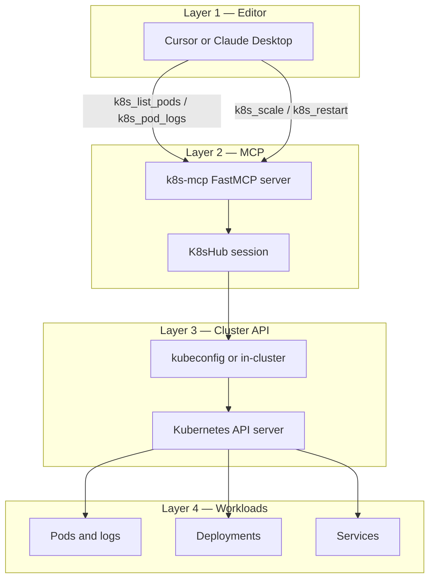
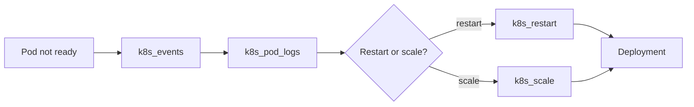

# Kubernetes MCP Server

Open-source MCP server owned by **Pawan Gunjkar** (`pawangunjkar@gmail.com` · [GitHub](https://github.com/Pawangunjkar)). MIT licensed.

Developers list pods, read logs, and restart their own Deployment from the editor. The server loads kubeconfig, or in-cluster config when that file is missing. Secret values are never returned. Pod delete requires `confirm=true`.

Sibling servers: [github-mcp](https://github.com/Pawangunjkar/github-mcp), [jenkins-mcp](https://github.com/Pawangunjkar/jenkins-mcp), [linux-ssh-mcp](https://github.com/Pawangunjkar/linux-ssh-mcp), [db-mcp](https://github.com/Pawangunjkar/db-mcp), [observability-mcp](https://github.com/Pawangunjkar/observability-mcp).

## Project information

| Item | Value |
| --- | --- |
| Package | `pawangunjkar-k8s-mcp` |
| Runtime | Python 3.10+, FastMCP, official Kubernetes client |
| Auth | `KUBECONFIG`, context, or in-cluster service account |
| Reads | namespaces, pods, logs, events, deployments, services, nodes, secret names |
| Writes | scale, rollout restart, delete one pod, apply Deployment or ConfigMap |

## Architecture





## Read tools

`k8s_list_namespaces`, `k8s_list_pods`, `k8s_pod_logs`, `k8s_events`, `k8s_list_deployments`, `k8s_list_services`, `k8s_list_nodes`, `k8s_list_secret_names`

Secret **names** are listed. Secret values are not returned.

## Write tools

| Tool | Effect |
| --- | --- |
| `k8s_scale` | Set Deployment replicas |
| `k8s_restart` | Roll a Deployment via `restartedAt` |
| `k8s_delete_pod` | Delete one pod. Requires `confirm=true` |
| `k8s_apply` | Create or patch a Deployment or ConfigMap from YAML |

## Cursor

```json
{
  "mcpServers": {
    "k8s": {
      "command": "uv",
      "args": ["run", "--directory", "C:/AI_Workspaces/Anti_Workspace/k8s-mcp", "server.py"],
      "env": {
        "KUBECONFIG": "C:/Users/you/.kube/config",
        "K8S_CONTEXT": "dev",
        "K8S_NAMESPACE": "ecs"
      }
    }
  }
}
```

If `KUBECONFIG` is empty, the server loads the default kubeconfig and falls back to in-cluster config.
